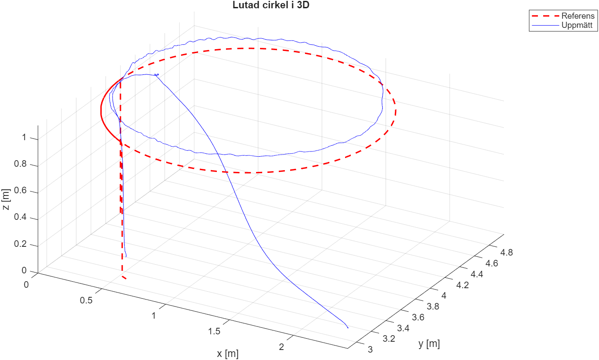
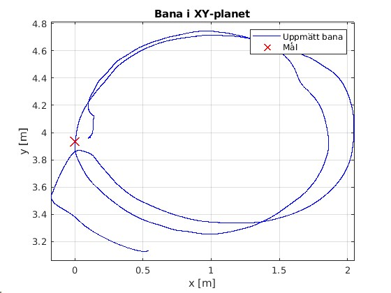
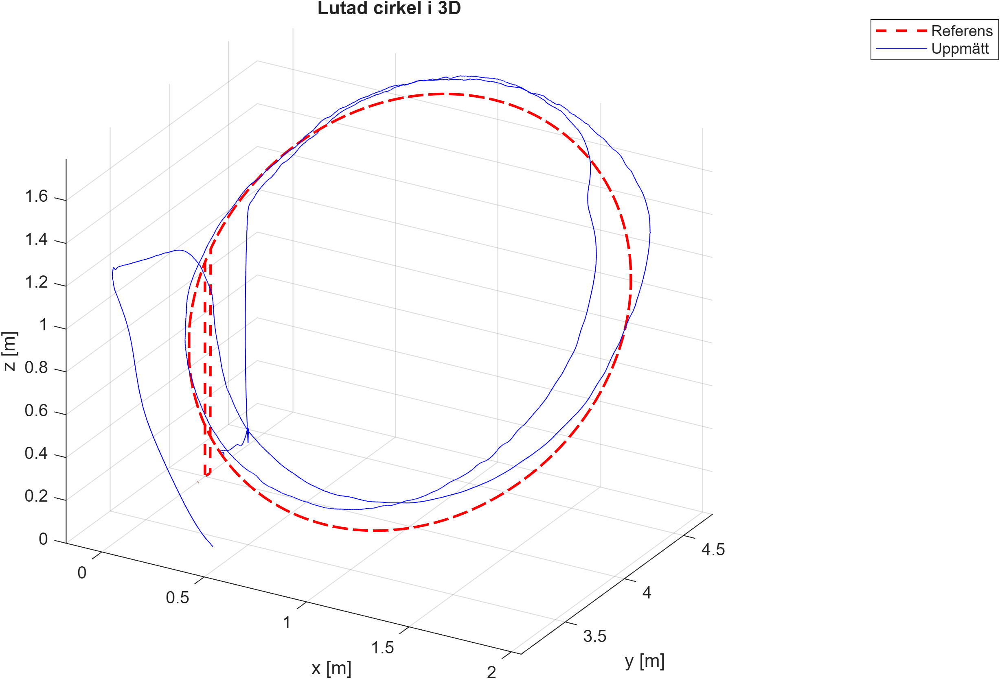

# Aerial Robotics – Lab 3: Crazyflie

Positions- och höjdreglering av en Crazyflie-drönare med Vicon-återkoppling, byggd i Simulink och flugen i den fysiska labben.
Drönaren flyger tre banor (Task 3): en **fyrkant**, en **cirkel** och en **cirkel lutad 45°**.

---

## Regulatorn

Drönarens egen firmware sköter attityden. Ovanpå den ligger en förenklad kaskadreglering i Simulink (`export_ros2_template.slx`, ROS 2):

| Styr | Regulator | Formel |
|---|---|---|
| Höjd → thrust | PD + feedforward | `T = T0·(1 + 0.42·(z* − z) − 0.35·ż)` |
| x/y → pitch | P på positionsfel + hastighetsdämpning | `pitch = 0.3·(e_x − v_x)` |
| x/y → roll | P på positionsfel + hastighetsdämpning | `roll = −0.4·(e_y − v_y)` |
| Riktning → yaw rate | P | `yaw_rate = 0.2·atan2(sin(ψ* − ψ), cos(ψ* − ψ))` |

Positionsfelet räknas i drönarens egen ram. Både drönarens position och referensen roteras med `rot2(ψ)ᵀ`:

```
[e_x; e_y] = rot2(ψ)ᵀ · [x* − x; y* − y]
           = [ cosψ·(x* − x) + sinψ·(y* − y);
              −sinψ·(x* − x) + cosψ·(y* − y)]
```

`v_x` och `v_y` är hastigheten från odometrin. Minustecknet på roll ligger i publishern (Gain −1), eftersom positiv roll lutar drönaren mot −y.

**Begränsningar och enheter**
- Thrust: `T` begränsas till 0–1 och skickas som `T · 60000` PWM. Med `T0 = 0.71` blir svävthrusten ungefär 42 600 PWM.
- Pitch och roll: ±1 rad, yaw rate: ±1 rad/s. Alla tre görs om från radianer till grader i publishern.
- Höjdreferensen går via en NödSwitch, en Rate Limiter (±0.2 m/s) och en begränsning till 0–1.8 m, vilket ger mjuk start och nödlandning.

---

## Banor (Task 3)

Banorna skapas i en MATLAB Function i Task 3-modellerna (`Cirkel_task3.slx`, `task3.slx`, `fyrkant_task3.slx`).
Funktionen räknar ut en lista med punkter längs banan och skickar **en punkt i taget** som referens till regulatorn.

**Waypoint-logik:** när drönaren är närmare än `min_dist = 0.25 m` från den aktuella punkten går funktionen vidare till nästa:

```
avstånd = √((x_mål − x)² + (y_mål − y)² + (z_mål − z)²)
om avstånd < 0.25 m  →  index = index + 1
```

Punkterna ligger tätt (ungefär 5 mm isär), så målet ligger hela tiden cirka 0.25 m framför drönaren längs banan. Det är alltså drönaren själv som bestämmer farten, inte en klocka.

**Gemensamma värden**

| Storhet | Värde |
|---|---|
| Startpunkt (Vicon) | `x0 = 0`, `y0 = 4` |
| Flyghöjd | `z0 = 1 m` |
| Radie | `r = 1 m` |
| Punkttäthet | en punkt per `v · 0.1 s = 0.005 m` längs banan (`v = 0.05 m/s`) |

Vinkeln längs cirkeln är

```
s = π + 2π · t/T,      T = 2πr / v,      t = 0.1, 0.2, …, T
```

Starten på `s = π` gör att första punkten hamnar exakt i startpunkten `(x0, y0)`, eftersom `cos π = −1` och `sin π = 0`.

### Cirkel

En platt cirkel på höjden `z0` med mitten i `(x0 + r, y0)`. Drönaren tittar hela tiden in mot mitten.

```
x   = x0 + r + r·cos s
y   = y0 +     r·sin s
z   = z0
ψ*  = atan2(y0 − y,  x0 + r − x)        (vinkeln på pilen från drönaren till mitten)
```

Mitten ligger i `(1, 4)`, och banan går mellan x = 0 och 2 och mellan y = 3 och 5.

### Lutad cirkel (45°)

Samma cirkel, vriden 45° runt x-axeln med rotationsmatrisen `Rx(45°)`:

```
p = c + Rx(45°) · [r·cos s;  r·sin s;  0]        c = (x0 + r, y0, z0)

            ⎡1     0         0    ⎤
Rx(45°)  =  ⎢0  cos 45°  −sin 45°⎥
            ⎣0  sin 45°   cos 45°⎦
```

vilket ger

```
x   = x0 + r + r·cos s
y   = y0 +     r·sin s · cos 45°
z   = z0 +     r·sin s · sin 45°
ψ*  = 0
```

Den del som i den platta cirkeln var ren y-rörelse delas upp lika mellan y och z (cos 45° = sin 45° ≈ 0.707):
- uppifrån blir banan en **ellips**, 2 m i x och 1.41 m i y
- höjden varierar mellan `1 − 0.71 ≈ 0.29 m` och `1 + 0.71 ≈ 1.71 m`
- yaw hålls fast på 0, och drönaren lutar sig åt alla håll med pitch och roll

---

## Resultat – Task 3

Röd streckad linje = referens, blå linje = uppmätt bana (Vicon).

### Fyrkant

<table>
  <tr>
    <td align="center"><br><sub>Bana i XY-planet</sub></td>
    <td align="center"><br><sub>Bana i 3D – lyft, fyrkant på 1 m höjd, landning</sub></td>
  </tr>
</table>

### Cirkel

<table>
  <tr>
    <td align="center"><br><sub>Bana i XY-planet</sub></td>
    <td align="center"><br><sub>Bana i 3D</sub></td>
  </tr>
</table>

### Lutad cirkel (45°)

<table>
  <tr>
    <td align="center"><br><sub>Bana i XY-planet – uppifrån blir den lutade cirkeln en ellips</sub></td>
    <td align="center"><br><sub>Bana i 3D – cirkeln lutad 45°</sub></td>
  </tr>
</table>

---

## Filer

Allt ligger i `v2/davidochgustav/`.

| Fil | Innehåll |
|---|---|
| `export_lab12.slx` | Modell för Task 1–2 (sväva och flyga till punkter) |
| `export_lab3.slx`, `task3.slx` | Modell för Task 3 (följer en referensbana) |
| `fyrkant_task3.slx`, `Cirkel_task3.slx` | Modellerna som användes för respektive bana |
| `export_parameter_test.slx` | Test för att hitta svävthrusten T0 |
| `task3_physical.m`, `export_task3.m` | Bygger referensbanorna och plottar resultatet |
| `plot_lab12.m`, `task3plot.m` | Plottskript |
| `fyrkant.mat`, `cirkel.mat`, `lutad.mat` | Loggad data från flygningarna |

### Köra en bana

1. Läs av drönarens startposition från Vicon och skriv in `x0`, `y0`, `yaw0` i banskriptet.
2. Välj `bana` (`'fyrkant'`, `'cirkel'` eller `'lutad'`) och kör sektion 1.
3. Kör Simulink-modellen, slå upp StartSwitch och NödSwitch.
4. När drönaren har landat: stoppa och kör sektion 2 för att plotta.
