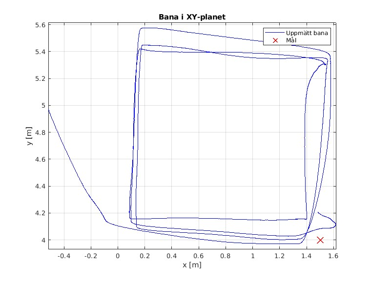
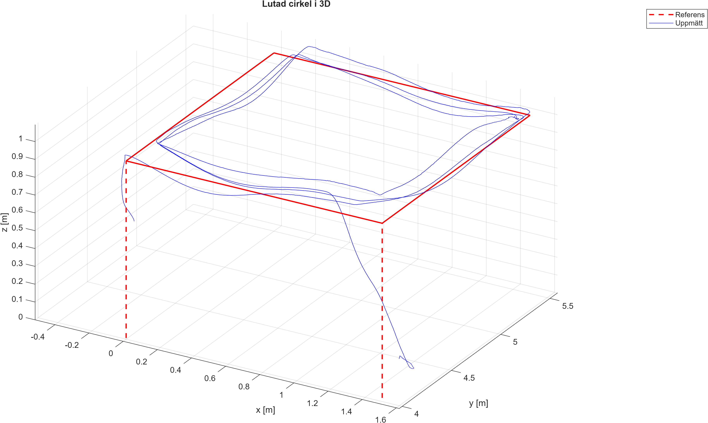
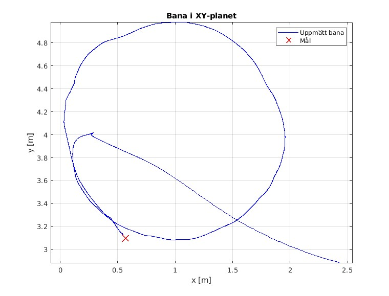

# Aerial Robotics – Lab 3: Crazyflie

Positions- och höjdreglering av en Crazyflie-drönare med Vicon-återkoppling, byggd i Simulink och flugen i den fysiska labben.
Drönaren flyger tre banor (Task 3): en **fyrkant**, en **cirkel** och en **cirkel lutad 45°**.

---

## Regulatorn

Drönarens egen firmware sköter attityden. Ovanpå den ligger en förenklad kaskadreglering i Simulink:

| Styr | Regulator | Formel |
|---|---|---|
| Höjd → thrust | PD + feedforward | `T = T0·(1 + 0.42·(z* − z) − 0.35·ż)` |
| x/y → pitch | P-kaskad (position → hastighet → lutning) | `pitch = 0.25·( cosψ·a + sinψ·b)` |
| x/y → roll | P-kaskad | `roll = −0.25·(−sinψ·a + cosψ·b)` |
| Riktning → yaw rate | P | `yaw_rate = 1.5·atan2(sin(ψ*−ψ), cos(ψ*−ψ))` |

där `a = 0.8·(x* − x) − vx` och `b = 0.8·(y* − y) − vy`.
Begränsningar: lutning ±0.15 rad, yaw rate ±1 rad/s, thrust 0–60000 PWM, och en Rate Limiter på 0.2 m/s för mjuk start och nödlandning.

---

## Resultat – Task 3

Röd streckad linje = referens, blå linje = uppmätt bana (Vicon).

### Fyrkant

<table>
  <tr>
    <td align="center"> Bana i XY-planet</td>
    <td align="center"> Bana i 3D – lyft, fyrkant på 1 m höjd, landning</td>
  </tr>
</table>

### Cirkel

<table>
  <tr>
    <td align="center"> Bana i XY-planet</td>
    <td align="center"> Bana i 3D</td>
  </tr>
</table>

### Lutad cirkel (45°)

   
  Bana i XY-planet – uppifrån blir den lutade cirkeln en ellips

---

## Filer

Allt ligger i `v2/davidochgustav/`.

| Fil | Innehåll |
|---|---|
| `export_lab12.slx` | Modell för Task 1–2 (sväva och flyga till punkter) |
| `export_lab3.slx`, `task3.slx` | Modell för Task 3 (följer en referensbana) |
| `fyrkant_task3.slx`, `Cirkel_task3.slx` | Modellerna som användes för respektive bana |
| `export_parameter_test.slx` | Test för att hitta svävthrusten T0 |
| `task3_physical.m`, `export_task3.m` | Bygger referensbanorna och plottar resultatet |
| `plot_lab12.m`, `task3plot.m` | Plottskript |
| `fyrkant.mat`, `cirkel.mat`, `lutad.mat` | Loggad data från flygningarna |

### Köra en bana

1. Läs av drönarens startposition från Vicon och skriv in `x0`, `y0`, `yaw0` i banskriptet.
2. Välj `bana` (`'fyrkant'`, `'cirkel'` eller `'lutad'`) och kör sektion 1.
3. Kör Simulink-modellen, slå upp StartSwitch och NödSwitch.
4. När drönaren har landat: stoppa och kör sektion 2 för att plotta.
